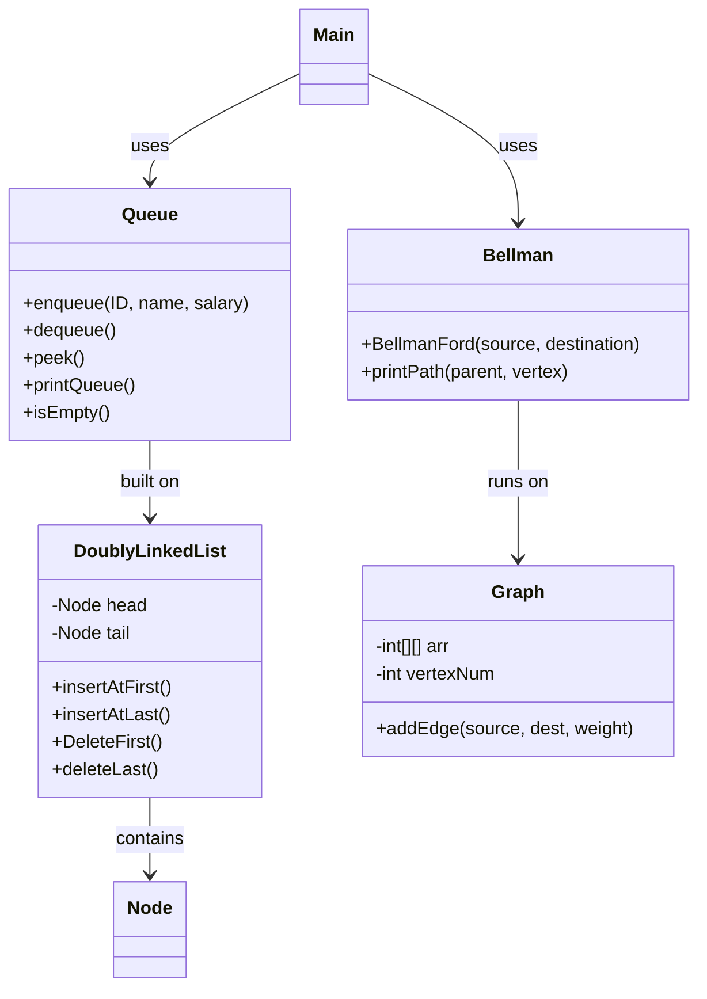
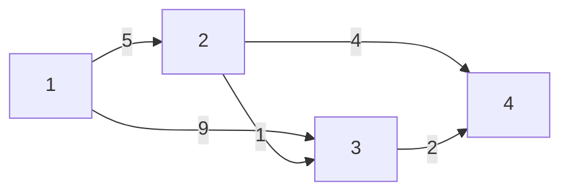

# Employee Management System

A console application in **Java** that manages employee records with a **queue built from scratch on a doubly linked list**, and finds the shortest path between locations with the **Bellman-Ford algorithm**. No built-in Java collections are used: every data structure is implemented by hand.


## Features

- **Add employees** with ID, name and salary
- **Delete employees** in first-in, first-out (FIFO) order
- **View all employees** currently in the queue
- **Find the shortest path** between two points in a weighted graph
- **Input validation:** rejects empty fields, duplicate IDs, negative salaries, and names with numbers or symbols, without crashing

## Data structures and algorithms

| Component | Implementation |
|---|---|
| `Node` | Stores one employee, with `next` and `previous` links |
| `DoublyLinkedList` | Insert/delete at both ends in **O(1)** using head and tail pointers |
| `Queue` | FIFO queue on top of the linked list: enqueue at the head, dequeue from the tail |
| `Graph` | Weighted directed graph stored as an **adjacency matrix** |
| `Bellman` | **Bellman-Ford** shortest path with path reconstruction and **negative-cycle detection** |



### The shortest-path graph

The program uses this weighted graph:



Going straight from 1 to 3 costs 9, but going 1 → 2 → 3 costs only 6. Bellman-Ford finds that the shortest route from 1 to 4 is **1 → 2 → 3 → 4** with a total distance of **8**.

**Why Bellman-Ford?** Unlike Dijkstra's algorithm, it still works when edges have negative weights, and it can detect a negative-weight cycle, where no shortest path exists. It runs in **O(V³)** here because the graph is stored as a V × V matrix.

## Sample run

```text
1.Enter new employee data
2.Delete employee data
3.Show all employees
4.Show shortest path
5.Exit
1
please Enter employee's ID
101
please Enter employee's name
Lina Haddad
please Enter employee's salary
900
employee enqueued: id: 101 name: Lina Haddad salary:900
...
2
Employee ID: 101 Name: Lina Haddad Salary: 900
employee deleted
...
4
enter source vertex
1
enter destination vertex
4
shortest distance=8
shortest path:
1 2 3 4
```

## How to run

You need Java 8 or newer. From the project folder:

```bash
javac -d out src/employeemanagementsystem/*.java
java -cp out employeemanagementsystem.Main
```

Or open the folder in Eclipse or IntelliJ IDEA and run `Main.java`.

## Project structure

```
src/employeemanagementsystem/
├── Main.java              # Menu, input handling and validation
├── Node.java              # Employee node
├── DoublyLinkedList.java  # Doubly linked list
├── Queue.java             # FIFO queue
├── Graph.java             # Weighted graph (adjacency matrix)
└── Bellman.java           # Bellman-Ford shortest path
```

## Author

**Lujain Naimat** · [GitHub](https://github.com/LujainNaimat)
